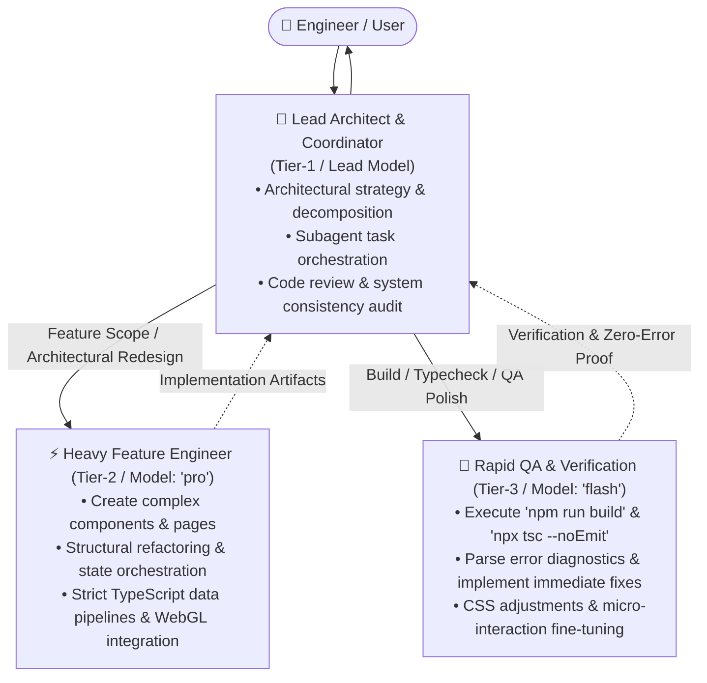

# AGENTS.md — Multi-Model Development Protocol & Architecture

> **Project:** Mammetbay Developer Portfolio v2 (`mammetbay_dev`)  
> **Canonical:** `https://mammetbay.dev`  
> **Technology:** Next.js 16.1.5 (App Router + Turbopack), React 19, TypeScript 5, Tailwind CSS v4, Framer Motion, GSAP 3

---

## 1. Hierarchical Multi-Model Orchestration Protocol

Development workflows across this repository adhere to a 3-tier autonomous agent hierarchy structured around model strengths and operational responsibilities:

### Tier 1: Lead Architect & Coordinator
- **Role:** Primary session coordinator. Analyzes high-level product and architectural requirements, maintains structural integrity, plans execution milestones, and orchestrates specialized subagents.
- **Task Lifecycle:**
  1. Deconstructs user requests into actionable engineering plans.
  2. Delegates heavy logic and multi-file changes to Tier-2 Feature Engineers (`invoke_subagent`, `Model: 'pro'`).
  3. Hands off completed changes to Tier-3 QA agents (`invoke_subagent`, `Model: 'flash'`) for automated build verification and linter sweeps.
  4. Delivers concise architectural reports directly to the user.

### Tier 2: Heavy Feature Engineers (Model: `pro`)
- **Trigger:** Creation of new pages, interactive WebGL2 modules, multi-language internationalization systems, or major component refactors.
- **Invocation:** Dispatched via `invoke_subagent` with `Model: 'pro'` and `Role: 'Feature Engineer'`.
- **Responsibilities:** Delivers clean, type-safe (strict TypeScript), and performance-optimized React 19/Next.js 16 code.

### Tier 3: Rapid QA, Testing & Micro-Fixes (Model: `flash`)
- **Trigger:** Post-implementation build verification (`npm run build`), TypeScript typecheck (`npx tsc --noEmit`), ESLint audits, and visual fine-tuning.
- **Invocation:** Dispatched via `invoke_subagent` with `Model: 'flash'` and `Role: 'QA & Rapid Fixer'`.
- **Responsibilities:** High-speed execution of terminal build commands, log triage, zero-error resolution, and automated formatting.

---

## 2. Standard Task Execution Lifecycle

Every feature, refactor, or optimization follows this lifecycle:

1. **[Architect] Planning:** Analyze the requirement, map file boundaries, and verify ownership constraints.
2. **[Feature Engineer] Coding:** Dispatch `pro` subagent to write or update target components in `src/components/`, `src/app/`, or `src/i18n/`.
3. **[QA Engineer] Verification:** Dispatch `flash` subagent to execute `npm run build` and ensure 0 compilation or lint errors.
4. **[Architect] Delivery:** Confirm production readiness and output a structured, concise summary.

---

## 3. Technology Stack & Engineering Standards

- **Next.js 16 (App Router):** Dynamic interactive components must explicitly declare `'use client';` at the top of the file.
- **Tailwind CSS v4:** Utilize `@theme` variables and utility classes in accordance with modern Tailwind v4 specifications (`globals.css`).
- **Dark Minimal Engineering Design Language:**
  - Base Surfaces: `#0E0E0E`, `#121212`, `#141414`, `#161616`
  - Accent Palette: Citrus Lime (`#E4FD97`), Signal Crimson (`#FF2A5F`)
  - Elevated Cards: `border border-white/10 bg-white/[0.02] backdrop-blur-md`
- **Iconography:** Use the centralized SVG icon library located at `src/components/Icons.tsx`.
- **Strict Type Safety:** Never use `any`. Interfaces such as `ProjectData`, `TranslationDictionary`, and `SkillCategory` must be comprehensively typed.
- **Zero-Error Standard:** Every committed task must pass `npm run build` with zero warnings or errors.
