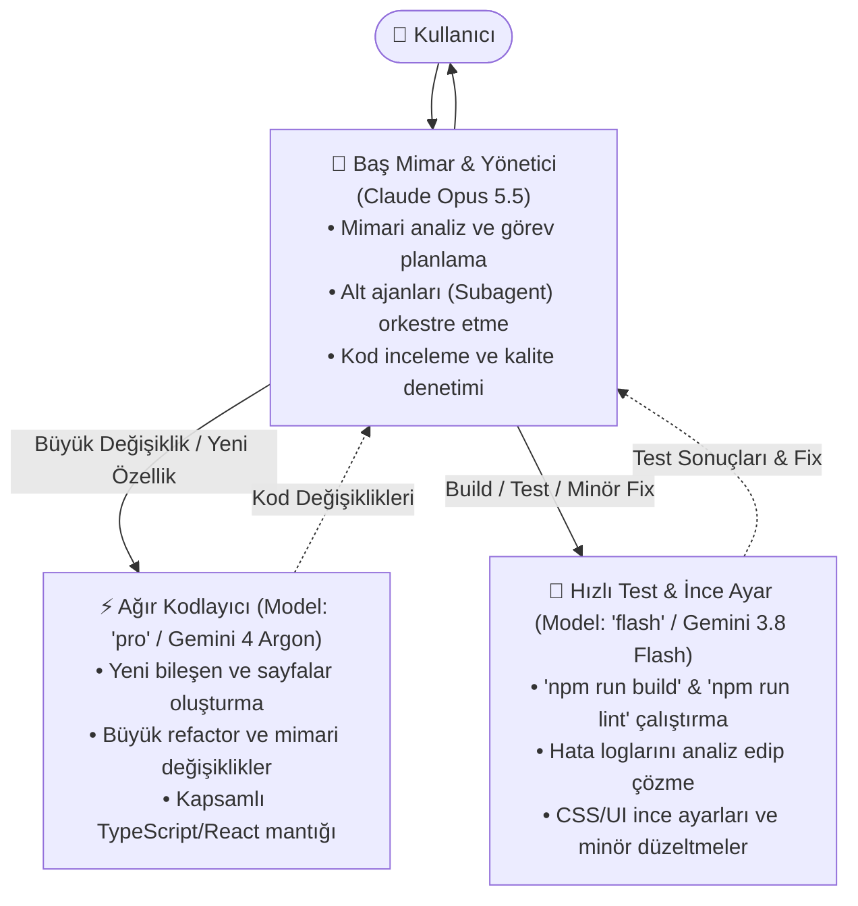

# AGENTS.md — Multi-Model Development Protocol & Architecture

> **Proje:** Mammetbay Developer Portfolio v2 (`mammetbay_dev`)  
> **Konum:** `D:\Workspace\Portfolio v2\mammetbay_dev`  
> **Teknoloji:** Next.js 16.1.5 (App Router + Turbopack), React 19, TypeScript 5, Tailwind CSS v4, Framer Motion

---

## 1. Hiyerarşik Çoklu Model Orkestrasyonu (Multi-Model Delegation)

Bu projede geliştirme işleri, rollerine ve modellerin uzmanlık alanlarına göre 3 katmanlı bir yapay zeka hiyerarşisiyle yürütülür:

### Katman 1: Baş Mimar & Planlayıcı (Claude Opus 5.5)
- **Rolü:** Oturumun ana ajanıdır. Kullanıcı taleplerini karşılar, proje mimarisini korur, kararları planlar ve süreci baştan sona yönetir.
- **Görev Akışı:**
  1. Kullanıcıdan gelen talebi analiz eder, gerekirse adımları belirler (`Plan`).
  2. Kapsamlı kod değişikliklerini doğrudan kendisi yapmak yerine alt ajana (`invoke_subagent`, `Model: 'pro'`) delege eder.
  3. Kod yazımı tamamlandığında, doğrulama ve test adımlarını hızlı test ajanına (`invoke_subagent`, `Model: 'flash'`) sevk eder.
  4. Test sonuçlarını değerlendirip kullanıcıya özet rapor sunar.

### Katman 2: Büyük Değişiklikler & Yeni Özellikler (Gemini 4 Argon - Medium / Model: `pro`)
- **Tetiklenme:** Yeni sayfa, yeni vitrin bileşeni, interaktif modül ekleme veya mevcut mimaride büyük refactor gerektiğinde.
- **Ajan Çağrısı:** `invoke_subagent` aracıyla `Model: 'pro'`, `Role: 'Feature Engineer'` olarak başlatılır.
- **Sorumluluk:** Temiz, tip güvenli (strict TypeScript), Next.js 16 standartlarına uygun kod üretir.

### Katman 3: Hızlı Testler, Minör Düzeltmeler & QA (Gemini 3.8 Flash - High / Model: `flash`)
- **Tetiklenme:** Kod yazıldıktan sonra derleme testi (`npm run build`), TypeScript tip denetimi (`npx tsc --noEmit`), ESLint kontrolü veya küçük stil/metin rötuşları gerektiğinde.
- **Ajan Çağrısı:** `invoke_subagent` aracıyla `Model: 'flash'`, `Role: 'QA & Rapid Fixer'` olarak başlatılır.
- **Sorumluluk:** Hızlıdır, terminal komutlarını çalıştırır, olası derleme/lint hatalarını tespit eder ve anında çözer.

---

## 2. Görev Yürütme Protokolü (Task Lifecycle)

Bir geliştirme yapılacağı zaman izlenecek standart süreç:

1. **[Opus 5.5] Planlama:** 
   - İhtiyacı analiz et, değişecek dosyaları belirle.
2. **[Gemini 4 Argon (pro)] Kodlama:** 
   - `invoke_subagent` ile kodlama ajanını görevlendir.
   - İlgili bileşenleri (`src/components/`, `src/app/`) yaz veya güncelle.
3. **[Gemini 3.8 Flash (flash)] Test & Düzeltme:** 
   - `invoke_subagent` ile test ajanını görevlendir.
   - `npm run build` koştur. Sıfır hata (0 error) sağlanana kadar minör rötuşları yap.
4. **[Opus 5.5] Kabul & Teslimat:** 
   - Son durumu doğrula, kullanıcıya kısa ve net rapor ver.

---

## 3. Teknoloji Yığını ve Kodlama Standartları

- **Next.js 16 (App Router):** Tüm dinamik istemci bileşenlerinin başında mutlaka `'use client';` bulunmalıdır.
- **Tailwind CSS v4:** Renkler ve değişkenler Tailwind v4 kurallarına (`@theme`, `globals.css`) uygun olmalıdır.
- **Tasarım Dili (Dark Cyberpunk / Minimal Tech):**
  - Arka planlar: `#08090C`, `#0D0F14`, `#13161F`
  - Vurgu Renkleri: Limon Yeşili (`#E4FD97`), Neon Pembe (`#FF2A5F`), Siber Mavi (`#00F0FF`)
  - Kartlar: `border border-white/10 bg-white/[0.02] backdrop-blur-md`
- **İkonlar:** `src/components/Icons.tsx` içerisindeki merkezi SVG ikon koleksiyonu kullanılmalıdır.
- **Tip Güvenliği:** Asla `any` kullanılmamalıdır. `ProjectData`, `TechCategory` gibi arayüzler eksiksiz doldurulmalıdır.
- **Sıfır Hata Prensibi:** Her değişiklikten sonra `npm run build` hatasız tamamlanmalıdır.
