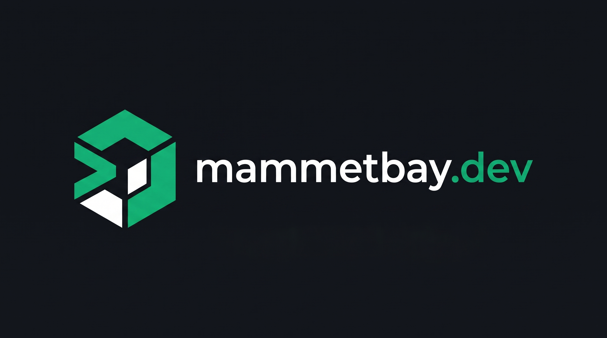

<p align="center">
  
</p>

# Mammetbay Mammetbayev — Systems Architectural Portfolio

[](https://nextjs.org/)
[](https://react.dev/)
[](https://www.typescriptlang.org/)
[](https://tailwindcss.com/)
[](https://developer.mozilla.org/en-US/docs/Web/API/WebGL2RenderingContext)
[](https://mammetbay.dev)
[](./LICENSE)

Official architectural portfolio and engineering systems showcase of **Mammetbay Mammetbayev** — Software Architect & AI Systems Engineer.

🌐 **Live Deployment:** [https://mammetbay.dev](https://mammetbay.dev)  
📄 **AI Machine-Readable Profile:** [https://mammetbay.dev/llms.txt](https://mammetbay.dev/llms.txt)

---

## ⚡ Architectural Overview

This platform is engineered as a high-performance, dark-aesthetic showcase presenting 10 real-world production architectures spanning distributed audio recommendation engines, schema-isolated multi-tenant B2B SaaS, cross-platform mobile apps reaching thousands of users, and confidential university speech AI research.

### Key Technical Pillars

- **Interactive WebGL2 Horizon Shader (`GradientASCII`):** A custom GLSL 300 es ASCII fragment shader rendering fluid interactive wave ripples and mouse velocity tracking. Dynamic canvas recreation ensures zero WebGL context loss during React 19 StrictMode remount cycles.
- **3D Optical Projection Carousel (`FlexCarousel`):** Powered by `ogl` (WebGL2), offering 4 lens presets (*Liquid Lens*, *Vortex*, *Arch*, and *Ribbon*). Fully synchronized with an **Active System Specification Deck** delivering live engineering telemetry.
- **Interactive Terminal Playground:** A responsive, in-browser command-line interface supporting commands like `musicai`, `waas`, `taryh`, `rd`, `projects`, `skills`, `neofetch`, and `contact`.
- **4-Language Native Internationalization (i18n):** Complete native translations across **Turkmen (`tk` — default)**, **English (`en`)**, **Russian (`ru`)**, and **Turkish (`tr`)** with instant switching and zero layout shift.
- **Enterprise SEO & Generative Engine Optimization (GEO):**
  - **Schema.org `@graph` JSON-LD:** Structured entities for `Person`, `WebSite`, `ProfilePage`, and `ItemList` (10 software applications).
  - **`public/llms.txt`:** Fully compliant machine-readable document optimized for LLM search crawlers (Perplexity, ChatGPT, Claude, Google Gemini).
  - **Next.js 16 Metadata API:** Comprehensive OpenGraph, Twitter card, geo tags, multilingual canonical alternates (`sitemap.ts`), and crawler permissions (`robots.ts`).

---

## 🚀 The 10 Engineered Systems

| # | System | Domain | Highlight Architecture |
| :---: | :--- | :--- | :--- |
| **01** | **MusicAI** | Distributed AI & ML | 13-Model ONNX acoustic analysis (`:8001`), in-memory signed URL streaming, Kafka event bus, Qdrant 256d vector search, Valkey live session state, and ClickHouse ALS collaborative filtering (`:8002`). |
| **02** | **WaaS Platform** | B2B SaaS & Systems | NestJS v11 + Fastify backend with strict PostgreSQL `Schema-per-Tenant` isolation (`tenant_<subdomain>`), `AsyncLocalStorage` context, and React 19 storefront simulator. |
| **03** | **Taryh Gollanma** | Mobile & Cross-Platform | 8,000+ Google Play downloads (v1.1.2) and live web portal. React Native + Expo Router with strategic battle cartography, archival photos, and offline local bookmarks. |
| **04** | **StudyMate AI** | Mobile & Cross-Platform | Open-source (MIT) student companion with Whisper STT lecture recording, Vision OCR notes parsing, and SM-2 Lite spaced repetition scheduling. |
| **05** | **TurkanaKafe** | Mobile & Cross-Platform | 3-tier hospitality operations suite uniting NestJS v11 backend, Next.js web storefront, and React Native Expo mobile app (`v1.0.1`) with Socket.io. |
| **06** | **Neural ASR & TTS** | Distributed AI & ML | Confidential university R&D engineering a 41.7M parameter FastConformer CTC recognizer and a 230-hour neural acoustic speech synthesis pipeline in PyTorch 2.x. |
| **07** | **Remotion Ad Pipeline** | Distributed AI & ML | 7-stage programmatic commercial video engine converting `brief.json` into beat-synchronized Remotion 9:16 vertical Reels and billboard advertising. |
| **08** | **AI Photo Studio** | B2B SaaS & Systems | Mobile-first generative photography SaaS preserving facial identity across hundreds of curated scenes using a 4-photo reference workflow. |
| **09** | **OSAI Japanese AI** | Mobile & Cross-Platform | Real-time English–Japanese voice dialogue mobile application and pronunciation coach powered by Expo Speech and NestJS AI backend. |
| **10** | **OwnSpeedtest CLI** | B2B SaaS & Systems | Zero-dependency Node.js 18+ network diagnostic tool benchmarking TCP/TLS handshake latency, jitter, and throughput against edge endpoints. |

---

## 🛠️ Technology Matrix

- **Framework:** Next.js 16.1.5 (App Router, Turbopack)
- **UI Library:** React 19.2.3, TypeScript 5.x
- **Styling:** Tailwind CSS v4, Native CSS Variables (`@theme`)
- **Graphics & Motion:** WebGL2 (`ogl`, custom GLSL fragment shaders), GSAP 3.15 (`ScrollTrigger`, `quickTo`), Framer Motion
- **Typography:** Google Fonts (`Bricolage Grotesque`, `Plus Jakarta Sans`, `JetBrains Mono`)
- **Linting & Code Quality:** ESLint 9, TypeScript Strict Mode (`noImplicitAny`, strict null checks)

---

## 📂 Repository Structure

```
mammetbay_dev/
├── public/
│   ├── favicon.ico
│   ├── llms.txt                     # Generative Engine Optimization (GEO) manifest
│   ├── logo.svg                     # Official emerald & white isometric cube emblem (SVG)
│   ├── logo-monochrome.svg          # Official monochrome white isometric cube emblem (SVG)
│   ├── logo.jpg                     # Square high-resolution brand mark
│   ├── logo-monochrome.jpg          # Square monochrome brand mark
│   └── logo-banner.jpg              # 16:9 official brand showcase banner
├── src/
│   ├── app/
│   │   ├── globals.css              # Tailwind v4 theme tokens & glassmorphism
│   │   ├── layout.tsx               # Root layout, Google Fonts subsets, Metadata & Schema
│   │   ├── page.tsx                 # Core single-page orchestration
│   │   ├── robots.ts                # Next.js MetadataRoute robots configuration
│   │   └── sitemap.ts               # Next.js MetadataRoute sitemap with i18n alternates
│   ├── components/
│   │   ├── ContactSection.tsx       # Transmit brief form & verified social endpoints
│   │   ├── Experience.tsx           # 4 Architectural blueprint pillars
│   │   ├── Footer.tsx               # Global footer, navigation links & copyright
│   │   ├── Hero.tsx                 # Interactive WebGL2 ASCII hero & architect dossier
│   │   ├── Icons.tsx                # Centralized SVG icon library
│   │   ├── JsonLdSchema.tsx         # Rich Schema.org @graph JSON-LD
│   │   ├── Navbar.tsx               # Editorial floating navigation bar
│   │   ├── ProjectCard.tsx          # Bento architecture specification card
│   │   ├── Projects.tsx             # FlexCarousel 3D projection & telemetry deck
│   │   ├── TechStack.tsx            # 3-domain technical competency matrix
│   │   ├── TerminalPlayground.tsx   # Interactive command-line inspector
│   │   └── ui/
│   │       ├── FlexCarousel.tsx     # WebGL2 OGL 3D projection carousel
│   │       └── GradientASCII.tsx    # WebGL2 GLSL ASCII background shader
│   └── i18n/
│       ├── LanguageContext.tsx      # Client-side language state & browser detector
│       ├── types.ts                 # Strict TypeScript translation dictionary types
│       └── locales/
│           ├── tk.ts                # Turkmen (Türkmençe - Default)
│           ├── en.ts                # English
│           ├── ru.ts                # Russian (Русский)
│           └── tr.ts                # Turkish (Türkçe)
├── AGENTS.md                        # Multi-model development protocol
├── LICENSE                          # Proprietary All Rights Reserved license
├── MEMORY.md                        # Architectural context & systems ledger
├── README.md                        # Public repository documentation
├── package.json
└── tsconfig.json
```

---

## 💻 Getting Started

### Prerequisites
- Node.js `20.x` or `22.x` recommended
- npm or pnpm

### Installation

```bash
# Clone the repository
git clone https://github.com/Mammetbay/mammetbay_dev.git

# Navigate to project directory
cd mammetbay_dev

# Install dependencies
npm install
```

### Development Server

Run the development server with Next.js Turbopack:

```bash
npm run dev
```

Open [http://localhost:3000](http://localhost:3000) with your browser to view the application.

### Production Build & Verification

```bash
# Typecheck
npx tsc --noEmit

# Production build
npm run build

# Start production server
npm run start
```

---

## 👤 Author & Contact

**Mammetbay Mammetbayev**  
Software Architect & AI Systems Engineer

- **Email:** [mammetbaydev@gmail.com](mailto:mammetbaydev@gmail.com)
- **GitHub:** [https://github.com/Mammetbay](https://github.com/Mammetbay)
- **Instagram:** [@mammetbay_dev](https://instagram.com/mammetbay_dev)
- **Google Play:** [Mammetbayev M.](https://play.google.com/store/apps/developer?id=Mammetbayev+M.)

---

## 📄 License & Copyright

**Copyright © 2026 Mammetbay Mammetbayev. All Rights Reserved.**

This repository is published publicly on GitHub as a **source-available engineering portfolio** for code inspection and architectural review only. Public viewing for recruitment and technical evaluation is welcomed, but **copying, redistributing, rebranding, or deploying this codebase or design as your own portfolio or commercial project is strictly prohibited** without explicit written permission from the author. See the [LICENSE](./LICENSE) file for full legal terms.

